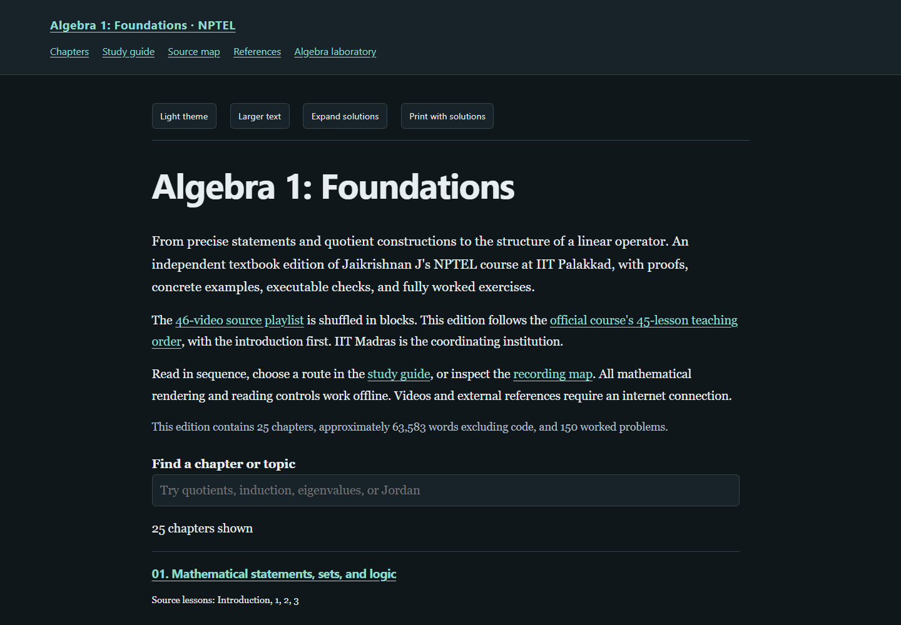

# Algebra 1: Foundations — lecture notes

[Read the book](https://az9713.github.io/nptel-algebra-1-iitm-notes/) ·
[Study guide](https://az9713.github.io/nptel-algebra-1-iitm-notes/book-overview.html) ·
[Source map](https://az9713.github.io/nptel-algebra-1-iitm-notes/source-map.html)

An independent, transcript-grounded textbook edition of **Prof. Jaikrishnan J's
NPTEL course, IIT Palakkad**, coordinated by IIT Madras.

The complete edition has **25 chapters, 150 fully solved problems, and 25
executed Python laboratories**, from sets and proofs through number systems,
linear algebra, minimal polynomials, and Jordan canonical form. Approximately
63,600 words of exposition, excluding code.

The [source playlist](https://www.youtube.com/playlist?list=PLyqSpQzTE6M_FrI5Yxkv_1x04TZPWWhrG)
contains an introduction and 45 lessons. Its entries are shuffled in blocks.
The notes follow the [official course outline](https://nptel.ac.in/courses/111106763),
with the introduction first. Original playlist positions remain in the source
inventory; the order is not obtained by reversing the playlist.



## Reading

Open `index.html` directly for an offline edition, or use GitHub Pages. MathJax,
styles, navigation, theme controls, searchable chapter index, solutions, print
support, and the interactive chain explorer are local. Videos and external
references require internet access. The reader defaults to dark mode.

- `chapter-*.html`: standalone reading chapters and JSON metadata.
- `chapters/`: directly authored HTML manuscripts and source ledgers.
- `book-overview.html`: reading routes, conventions, and dependencies.
- `source-map.html`, `source-manifest.json`: every recording in teaching order.
- `references.html`: inspected primary references and attribution.
- `numerical-lab.html`: experiment guide and interactive Jordan-chain explorer.
- `analysis-ir.json`, `validation/`: source analysis and scoped review evidence.

## Rebuild and check

Use Python 3.10+ with `pip install -r requirements.txt`, then:

```text
python tools/build_book.py
python tools/check_chapter_code.py
python tools/run_content_checks.py
python tools/validate_books.py
python tools/validate_books.py --browser
python tools/verify_release.py
```

Browser checks require Playwright's Chromium or installed Google Chrome. The
validator uses installed Chrome on Windows when available; otherwise install
the Playwright browser with `python -m playwright install chromium`.

The public export rebuilds without captions or downloaded references. Source
acquisition scripts are retained for provenance and future maintenance, but
their private inputs are not needed to build or read the edition.

## Evidence and scope

All extracted source texts were read sequentially. A separate AI scientific
editor checked every chapter's proofs, six solutions, source fidelity, cited
reference sections, and code, with acceptance bound to the exact manuscript
hash. This is not human expert certification or formal proof verification.
Code execution, static checks, offline browser checks, and clean-export
reproduction have separate evidence in `validation/summary.json`.

Caption corrections and added teaching material are identified in chapter
ledgers. Comprehensive audiovisual review is not claimed. The complete real
field existence theorem and fundamental theorem of algebra are explicit
background dependencies, not newly proved here.

See [WORKFLOW.md](WORKFLOW.md), [THIRD-PARTY.md](THIRD-PARTY.md), and
[LICENSE](LICENSE). This edition is unofficial; attribution implies no
endorsement by NPTEL, the institutions, instructor, or reference authors.
